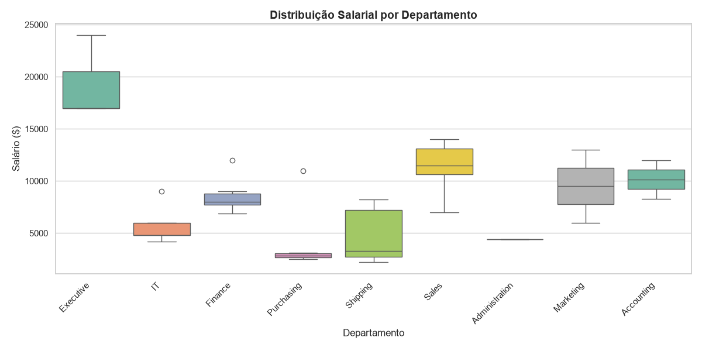
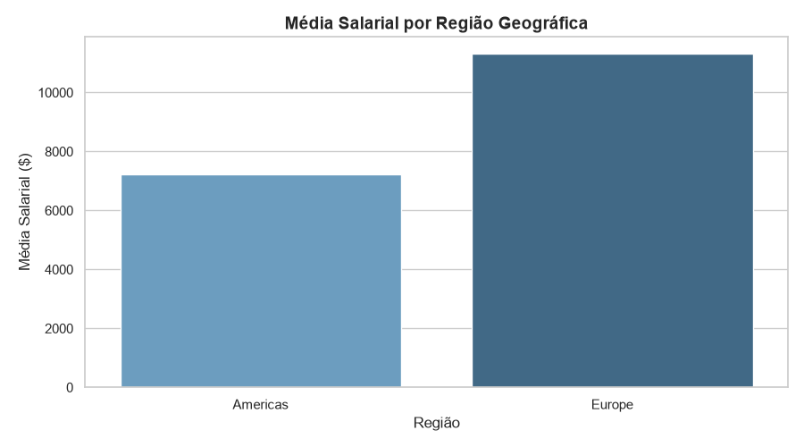
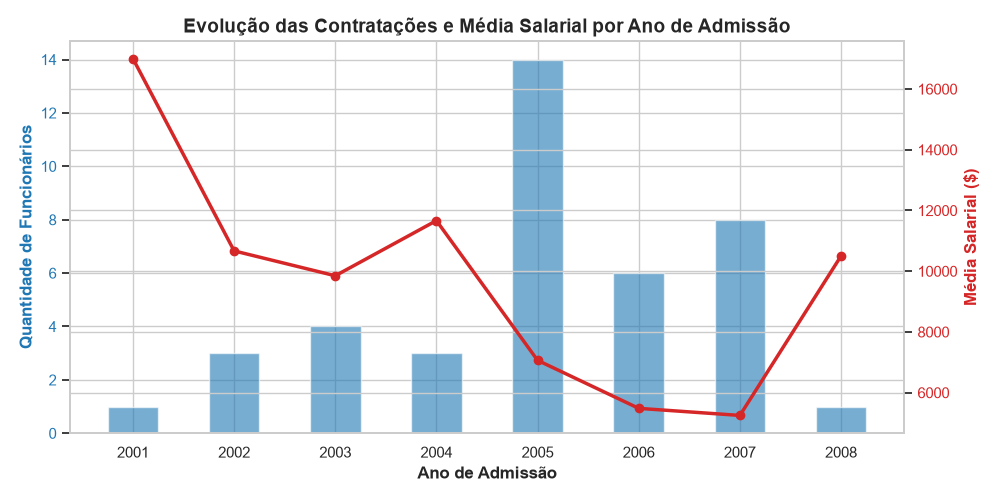

# BI & Análise de Dados de RH (HR FreeSQL)

Este repositório reúne um projeto de análise de dados de Recursos Humanos, desenvolvido com SQL e Python.

O objetivo foi explorar uma base de dados de funcionários, analisar a distribuição salarial e identificar padrões relacionados a departamentos, cargos, regiões e anos de admissão.

## Sobre o projeto

- **Aluno:** Maicon da Silva
- **Turma:** Business V3 (Ciclo 2)
- **Módulo:** 1 — REC

Utilizei o VS Code para desenvolver as consultas SQL, executar o script Python e organizar a documentação do projeto.

---

## Objetivo da análise

A proposta foi entender melhor como os salários estão distribuídos na empresa e quais padrões podem ser identificados a partir dos dados disponíveis.

Durante a análise, procurei responder às seguintes perguntas:

- Quais departamentos apresentam as maiores e menores remunerações?
- Existem diferenças salariais entre as regiões?
- Em quais anos ocorreram mais contratações?
- Como os salários atuais variam entre funcionários admitidos em anos diferentes?

A ideia foi utilizar os dados para identificar padrões e gerar informações que ajudem a compreender melhor o cenário de Recursos Humanos.

---

## Base de dados

Os dados foram obtidos no esquema **HR**, disponível no banco de dados FreeSQL.

As tabelas utilizadas foram:

- `EMPLOYEES`: informações dos funcionários, incluindo salário, data de admissão, departamento e cargo.
- `DEPARTMENTS`: informações sobre os departamentos.
- `JOBS`: cargos e faixas salariais.
- `LOCATIONS`, `COUNTRIES` e `REGIONS`: informações geográficas.

As tabelas foram relacionadas por meio de consultas SQL para preparar os dados utilizados nas análises.

---

## Desenvolvimento

### 1. Extração dos dados com SQL

Foram desenvolvidas três consultas SQL no FreeSQL, cada uma com um objetivo específico.

- **`query_1.sql`**: relaciona funcionários, departamentos e cargos utilizando `LEFT JOIN`, considerando apenas funcionários vinculados a um departamento. O resultado foi exportado para `query_01.csv`.
- **`query_2.sql`**: relaciona funcionários, departamentos, localizações, países e regiões. A consulta utiliza `LEFT JOIN` e considera registros com região identificada. O resultado foi exportado para `query_02.csv`.
- **`query_3.sql`**: reúne o ID do funcionário, a data de admissão, o ano de entrada na empresa, o salário, o departamento e o cargo. Os registros são ordenados pela data de admissão, em ordem crescente. O resultado foi exportado para `query_03.csv`.

### 2. Análise e visualização com Python

Com os dados exportados, utilizei o script `analise.py` para realizar os cálculos estatísticos e gerar os gráficos.

As principais bibliotecas utilizadas foram:

- `pandas`: manipulação e análise dos dados.
- `matplotlib`: criação de gráficos.
- `seaborn`: visualização e comparação dos dados.

As análises incluíram:

- Cálculo da média, mediana, salário mínimo e salário máximo.
- Distribuição dos salários por departamento.
- Comparação da média salarial entre regiões.
- Quantidade de admissões e salários atuais por ano de entrada na empresa.

Os gráficos gerados foram salvos nos seguintes arquivos:

- `boxplot_salarios_dept.png`
- `media_salario_regiao.png`
- `admissoes_por_ano.png`

---

## Resultados

### Salários por departamento

O boxplot permite comparar a distribuição dos salários entre os departamentos, observar a dispersão dos valores e identificar possíveis diferenças entre as remunerações.



### Média salarial por região

A comparação das médias salariais permite observar diferenças entre as regiões representadas na base de dados.



### Admissões por ano

O gráfico apresenta a distribuição das contratações ao longo dos anos e permite comparar os salários atuais dos funcionários de diferentes períodos de admissão.



---

## Principais observações

- **Média e mediana salarial:** a média geral ficou acima da mediana, indicando a influência de salários mais elevados nos resultados.
- **Ano de admissão:** a comparação considera os salários atuais dos funcionários agrupados pelo ano em que foram contratados. Portanto, não representa o salário inicial nem a evolução salarial individual.
- **Quantidade de funcionários:** anos com poucas admissões podem apresentar resultados menos representativos, o que deve ser considerado na interpretação dos gráficos.
- **Limitações da análise:** não foram considerados fatores como custo de vida, impostos ou inflação regional, que poderiam influenciar a comparação do poder de compra entre regiões.

Esses pontos reforçam a importância de interpretar os resultados considerando as características e as limitações dos dados disponíveis.

---

## Como executar o projeto

### 1. Clone o repositório

```bash
git clone https://github.com/smaicon/projeto-hr-bi-analise.git
cd projeto-hr-bi-analise
```

### 2. Instale as bibliotecas

```bash
pip install pandas matplotlib seaborn
```

### 3. Execute o script

```bash
python analise.py
```

Antes de executar, verifique se os arquivos CSV exportados do FreeSQL estão no diretório esperado pelo script `analise.py`.

As consultas SQL podem ser executadas no FreeSQL para gerar os arquivos utilizados na análise.

---

## Considerações finais

O projeto permitiu aplicar conhecimentos de SQL e Python na exploração de dados de Recursos Humanos, desde a extração e organização das informações até a criação de gráficos e a interpretação dos resultados.

A experiência também reforçou a importância de combinar análise estatística e visualização de dados para identificar padrões e compreender melhor as informações disponíveis.

